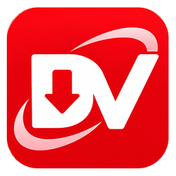
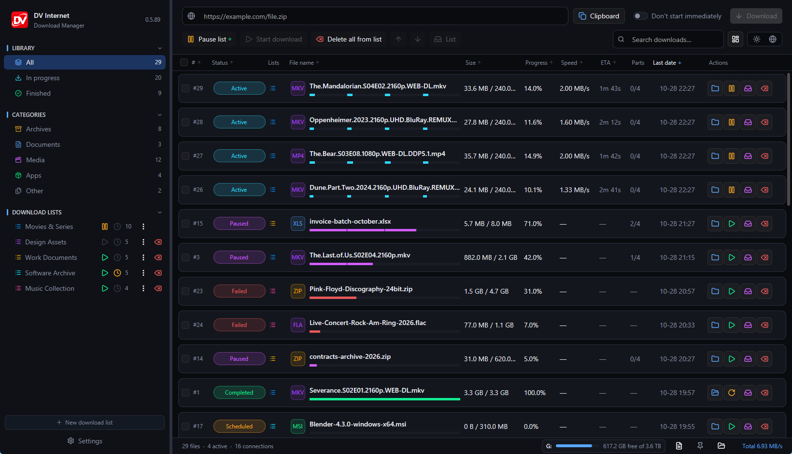
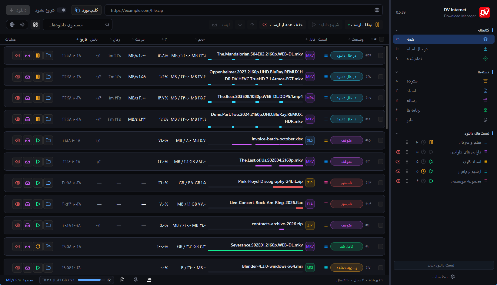
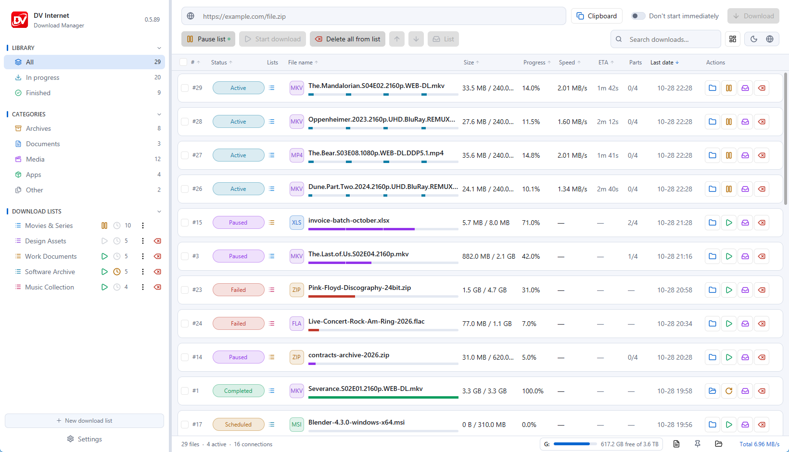
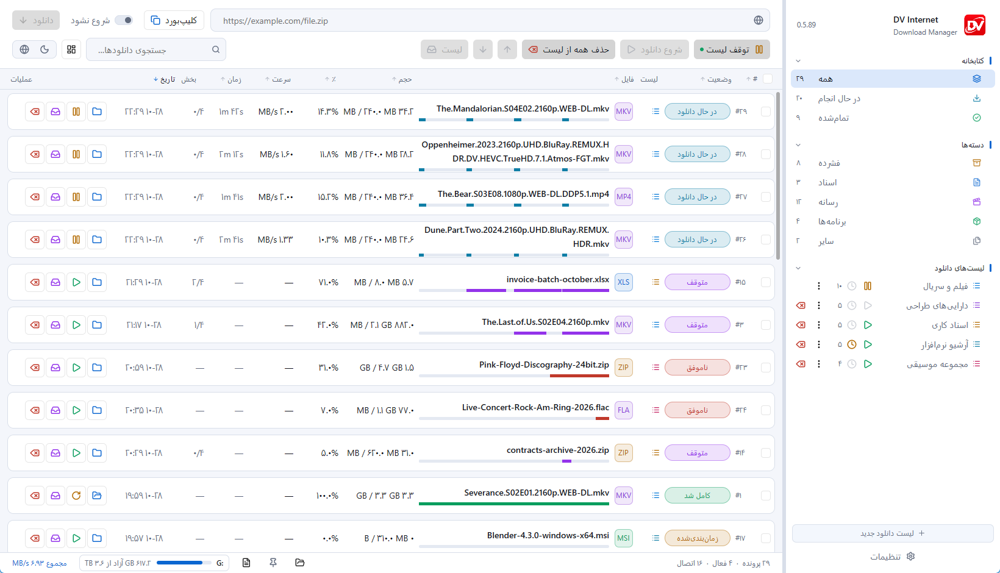
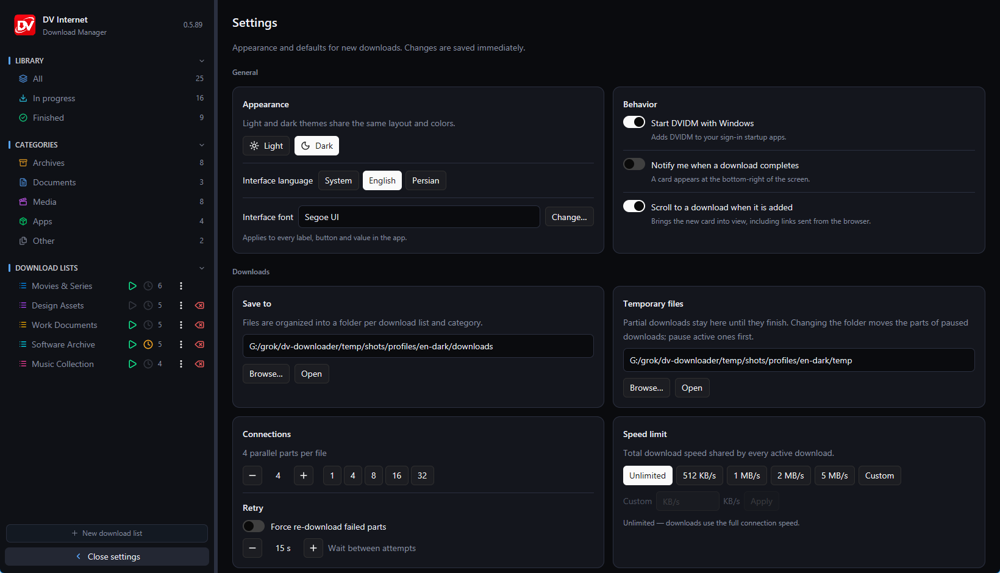
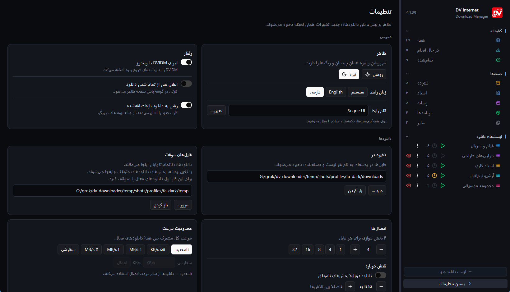
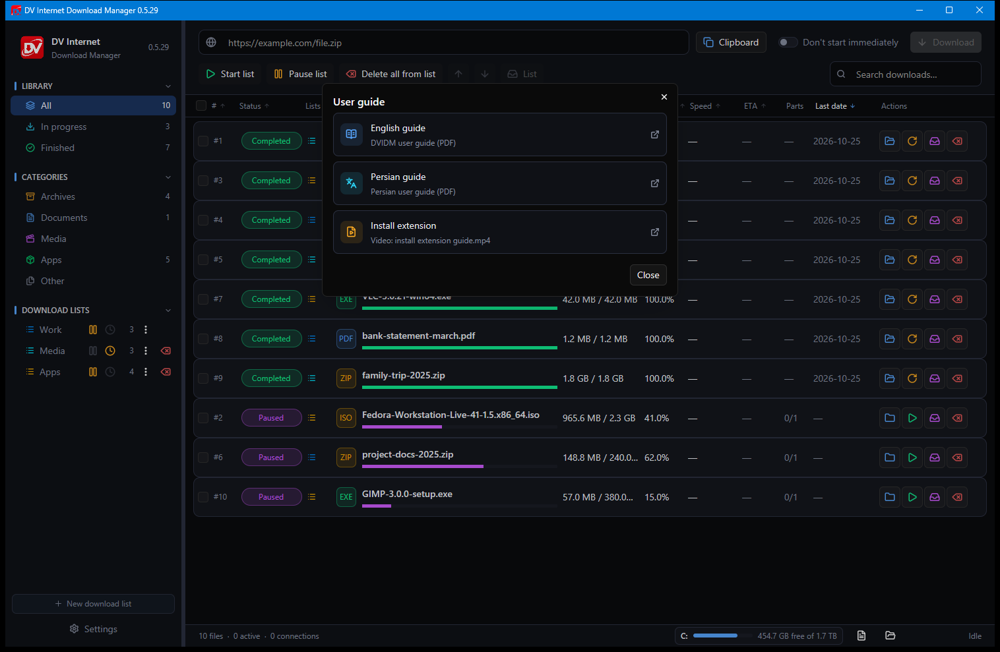

<div align="center">



# DV Internet Download Manager

**Fast, segmented downloads for Windows — with download lists, schedules, speed control and Chrome integration.**


<br />

[**Download DVIDM**](https://github.com/davoodtaba-glitch/DVIDM/releases/latest/download/DVIDM-Setup.msi) &nbsp;·&nbsp;
[Portable zip](https://github.com/davoodtaba-glitch/DVIDM/releases/download/v0.5.89/DVIDM-Portable-0.5.89.zip) &nbsp;·&nbsp;
[English guide](docs/USER-GUIDE.pdf) &nbsp;·&nbsp;
[راهنمای فارسی](docs/USER-GUIDE.fa.pdf) &nbsp;·&nbsp;
[Extension video](docs/install%20extension%20guide.mp4)

</div>

---



## What is DVIDM?

DVIDM is a desktop download manager for Windows built around **segmented, multi-connection transfers**. It splits a file across up to 32 connections, resumes paused downloads, retries broken parts, and keeps everything organized in lists, categories and schedules — all in a compact dark interface.

The package includes a **Chrome / Edge extension** that sends links and pages straight to the app, a **Persian right-to-left interface**, plus **English and Persian user guides** and a short **extension install video**.

---

## Highlights

| | |
|---|---|
| **Segmented downloads** | Up to 32 parallel connections per file, with automatic part retry and resume. |
| **Download lists** | Colored lists, per-list parallelism, scheduled sessions with a start countdown and session length, and optional shutdown when a list window closes. Start or pause a whole list from its sidebar button; the main Start list button pulses while a list is downloading. |
| **Queue control** | Start, pause and re-order downloads; hold new downloads with *Don't start immediately*. |
| **Speed limit** | Global bandwidth cap from 0 to 1 GB/s. |
| **Browser integration** | Send links and pages from Chrome or Edge. Choose the shortcut key in Settings — Ctrl, Alt, Shift, Insert or a combination — then hold it and click a file link. Selecting text also opens a compact DVIDM quick menu near the pointer. Links that need your browser session work too, and the saved file keeps its real name. |
| **Persian & RTL** | Interface language selector (System, English, فارسی, العربية). Persian and Arabic flip the whole interface right-to-left, with Persian wording, readable numbers and normal text editing. |
| **Proxy** | No proxy, Windows system proxy, or manual HTTP / SOCKS5 with optional credentials. Windows proxy changes are picked up automatically. |
| **Smart organization** | Categories, search, sortable columns and a **Last date** column showing the last start time with full date/time on hover. |
| **File tools** | Delete asks before removing a download and can delete the file from disk; opening a download's folder selects the file in Explorer. |
| **Update check** | Checks GitHub from the logo menu and every two days in the background. **Download installer** adds the MSI to DVIDM's own downloads. A fading message appears at startup when a newer version is available. |
| **Ready-to-use defaults** | Saves to your Windows **Downloads** folder, partial files in `%TEMP%\DVIDM`, and starts with Windows on first launch. |
| **Tray and notifications** | Close to tray, single instance, fading desktop completion cards with an option to turn them off. |
| **Download insights** | File Properties shows active download time and average speed, with paused time excluded. |
| **Organized settings** | Appearance and language, folders, connections and retries, browser types and network options are grouped into clear cards that use the full window. |
| **Custom list colours** | Pick a palette colour or open the colour picker and choose any shade for each list. |
| **Your table** | Show or hide columns, drag the dividers to resize them, and keep the layout between runs. |
| **One-off folders** | Change the save folder of a single download from Properties; partial data moves with it. |
| **Quick appearance** | Switch light/dark and the interface language directly from the main window. |
| **Faster selection** | Click a card to select it, drag across cards, or click empty space to clear. Right-click selects before opening Properties. |
| **Floating downloads window** | Follow active downloads in a small always-on-top card. Pause or start each download from the card, expand it to see more, and double-click a row to open it in the main window. |
| **Smooth list motion** | Cards slide into place when a download starts, pauses or changes position — in the main window and in the floating card. |
| **Toolbar controls** | Dedicated buttons start or pause the current list and the selected downloads, with a pulsing dot while a list is downloading. |
| **Bilingual help** | Full guides in **English** and **Persian**, plus a video walkthrough for the extension. |

---

## Screenshots

| English | Persian (فارسی) |
| :---: | :---: |
|  |  |
|  |  |

| Settings | تنظیمات |
| :---: | :---: |
|  |  |


## Download and install

| File | Description |
|---|---|
| [`installer/DVIDM-Setup.msi`](https://github.com/davoodtaba-glitch/DVIDM/releases/latest/download/DVIDM-Setup.msi) | Windows installer (64-bit, no administrator rights required) — also attached to [Releases](https://github.com/davoodtaba-glitch/DVIDM/releases) |
| [`portable/DVIDM-Portable-0.5.89.zip`](https://github.com/davoodtaba-glitch/DVIDM/releases/download/v0.5.89/DVIDM-Portable-0.5.89.zip) | Portable build: extract and run, no installer |
| [`extension/chrome-extension/`](extension/chrome-extension) | Unpacked Chrome / Edge extension |
| [`extension/DVIDM-chrome-extension.zip`](extension/DVIDM-chrome-extension.zip) | Same extension as a zip archive |
| [`docs/`](docs) | English and Persian guides, and the extension video |

### Install DVIDM

1. Download **`DVIDM-Setup.msi`** and run it.
2. If **Windows protected your PC** appears, choose **More info → Run anyway** (the build is not code-signed).
3. Follow the wizard and launch DVIDM from the desktop or Start menu.
4. On first launch, DVIDM saves to `Downloads` and uses `%TEMP%\DVIDM` for partial files. Both folders can be changed later in **Settings**.

> Requires Windows 10 or Windows 11, 64-bit. The installer is per-user and installs to `%LOCALAPPDATA%\Programs\DVIDM`.

### Portable version

Prefer not to install anything? Download the **portable zip**, extract it to a writable folder, and run `DVIDM.exe`. Settings, the download catalog and the debug log stay in that folder, so it can be moved or deleted as one unit. On first run DVIDM enables start-with-Windows; turn it off in **Settings → Startup** for a setup that leaves no trace outside the folder.

---

## Browser extension

The extension talks to the running app over a local connection (`127.0.0.1:52137`). Nothing is sent to the internet.

1. Keep **DVIDM running**.
2. Open `chrome://extensions` (or `edge://extensions`).
3. Turn on **Developer mode**.
4. Click **Load unpacked** and select:
   ```
   %LOCALAPPDATA%\Programs\DVIDM\chrome-extension
   ```
5. Pin the extension to the toolbar. Select links on a page and choose **Send selected links**, or use the right-click menu. Copied links can also be sent from DVIDM's **Clipboard** button.
6. Choose the shortcut key in **Settings → Browser shortcut**, then hold it and click a file link to send it straight to DVIDM. Normal page links are untouched. The file-type list is configurable in the same card (`.safetensors` and types up to 32 characters are supported). Selecting text opens a quick DVIDM menu near the pointer; use its checkbox to turn that menu off.

Portable build: choose the `chrome-extension` folder next to `DVIDM.exe` when loading the extension. After copying updated extension files, press **Reload** on the extension card.

<div align="center">

[**Watch the extension video (MP4)**](docs/install%20extension%20guide.mp4)

</div>

---

## User guides

| Language | Guide |
|---|---|
| English | [`docs/USER-GUIDE.pdf`](docs/USER-GUIDE.pdf) |
| Persian (فارسی) | [`docs/USER-GUIDE.fa.pdf`](docs/USER-GUIDE.fa.pdf) |
| Video | [`docs/install extension guide.mp4`](docs/install%20extension%20guide.mp4) |

The same guides and video are installed with the app and available from the **User guide** menu behind the DV logo.



---

## Frequently asked questions

**Windows shows “Windows protected your PC”.**
The application is not code-signed yet. Click **More info**, then **Run anyway**.

**The extension says it cannot reach DVIDM.**
Start DVIDM and keep it running. Only one instance can run at a time, and the extension connects to the local port `52137`.

**My download or temp folder disappeared (external drive removed).**
DVIDM detects this at startup and falls back to the Windows **Downloads** folder and `%TEMP%\DVIDM`, then remembers the change.

**Can I turn off completion notifications?**
Yes — **Settings → Notifications**.

**Does DVIDM send telemetry?**
No. Downloads go directly to the source server. The extension only communicates with the local app.

**How do I uninstall it?**
Use **Settings → Apps → Installed apps → DV Internet Download Manager → Uninstall**. Downloaded files are not removed.

---

## Version

Current release: **0.5.89** — see [CHANGELOG.md](CHANGELOG.md) for user-facing changes.

---

## License

DVIDM is **freeware**. See [LICENSE](LICENSE) for the end-user license terms.

Bundled interface icons are from [Untitled UI](https://www.untitledui.com/) and remain under their own license.

<div align="center">
<sub>Built for Windows 10 and 11. Download responsibly and respect the terms of the sites you use.</sub>
</div>
